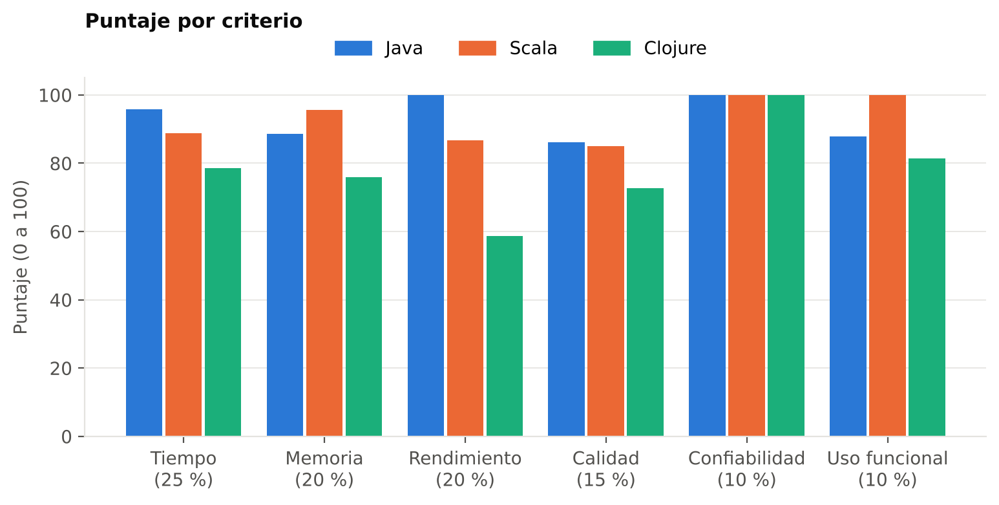

# Simulador de operaciones aeroportuarias · Comparativo Java · Scala · Clojure

Proyecto final de **Lenguajes y Paradigmas de Programación** · Universidad de Medellín · Profesor: JuanGui

**Integrantes:** Sebastián Villa · Miguel Guarnizo · Juan Esteban Echavarría

## Objetivo

Implementar el **mismo simulador de operaciones aeroportuarias** en tres lenguajes (Java, Scala y Clojure),
con los mismos requisitos y los mismos resultados, aplicando los principios de la programación funcional.
Sobre esas tres versiones se ejecuta un **experimento**: las mismas cargas de trabajo y las mismas condiciones
para los tres lenguajes. Con las métricas obtenidas, un mecanismo **determina automáticamente** cuál lenguaje
se comporta mejor para este problema.

**El simulador:** gestiona vuelos, asigna pistas, organiza despegues y aterrizajes y controla retrasos.
Entidades: Avión, Vuelo, Pista, Aeropuerto y TorreControl. Además, asigna las pistas automáticamente
según prioridades y disponibilidad.

## Criterios de comparación (definidos por el profesor)

| Criterio | Peso |
|---|---|
| Tiempo de ejecución | 25 % |
| Consumo de memoria | 20 % |
| Rendimiento (operaciones por unidad de tiempo) | 20 % |
| Calidad de código | 15 % |
| Confiabilidad | 10 % |
| Uso funcional | 10 % |

## Resultado

| Posición | Lenguaje | Tiempo | Memoria | Rendimiento | Calidad | Confiabilidad | Uso funcional | **Final** |
|---|---|---|---|---|---|---|---|---|
| 1.º | **Java** | 95,74 | 88,53 | 100,00 | 86,22 | 100,00 | 87,77 | **93,35** |
| 2.º | Scala | 88,87 | 95,70 | 86,66 | 85,06 | 100,00 | 100,00 | **91,45** |
| 3.º | Clojure | 78,64 | 75,97 | 58,71 | 72,78 | 100,00 | 81,35 | **75,65** |

Las tres versiones producen salidas idénticas en los 19 casos de verificación. Java gana en 6 de 7 variantes de
la prueba de solidez (sin el criterio de Rendimiento gana Scala). Análisis completo en el
[informe técnico](entrega/Informe_tecnico.docx).



## Cómo ejecutarlo

**El simulador, en cualquiera de los 4 lenguajes** (Java, Scala, Clojure y Python, que es la implementación de
referencia y no compite). Si el `.jar` no existe o el código cambió, `simular.sh` lo construye solo.

```bash
bash simular.sh java                     # ejemplo E0; también scala, clojure o python
bash simular.sh scala V1                 # otro escenario: E0, V1, V2, V3, V4, C1, X1
bash simular.sh clojure pistas.csv vuelos.csv salida/mia   # archivos propios
bash simular.sh todos V2                 # los 4 lenguajes y compara sus salidas byte a byte
bash simular.sh                          # menú interactivo
```

Las salidas quedan en `salida/<lenguaje>/<escenario>/`. En IntelliJ están las mismas opciones en la carpeta
**Simulador** del selector de ejecución (Run): «Simular · Java», «· Scala», «· Clojure», «· Python (referencia)»,
«· los 4 y comparar» y «· menú». Para otro escenario, cambie *Script options* (por ejemplo `java V1`).

**El experimento:**

```bash
bash experimento/verificar.sh            # construye las tres versiones y verifica la equivalencia (19 casos)
python3 experimento/ejecutar.py          # medición completa (unos 20 minutos)
python3 experimento/calidad.py && python3 experimento/funcional.py
python3 experimento/clasificar.py && python3 experimento/graficos.py
python3 informe/generar_informe.py       # informe técnico en entrega/
```

## Estado del trabajo

El proyecto avanza por bloques. Antes de pasar al siguiente bloque se toman y registran todas las decisiones
del anterior ([método de trabajo](docs/00_metodo_de_trabajo.md) · [registro de decisiones](docs/decisiones.md)).

| # | Bloque | Estado |
|---|---|---|
| 0 | Marco: repo, herramientas y equipo | ✅ |
| 1 | Requerimientos ([01_requerimientos.md](docs/01_requerimientos.md)) | ✅ |
| 2 | Modelo y contrato ([02_modelo_y_contrato.md](docs/02_modelo_y_contrato.md)) | ✅ |
| 3 | Diseño del experimento ([03_experimento.md](docs/03_experimento.md)) | ✅ |
| 4 | Criterios y clasificación ([04_criterios.md](docs/04_criterios.md)) | ✅ |
| 5 | Implementación en Java, Scala y Clojure, verificada contra la referencia (`bash experimento/verificar.sh` o «Verificar equivalencia» en IntelliJ) | ✅ |
| 6 | Ejecución y medición (`python3 experimento/ejecutar.py`): 198 ejecuciones, todas correctas | ✅ |
| 7 | Consolidación y ranking automático ([clasificacion.md](resultados/clasificacion.md)) | ✅ |
| 8 | Informe técnico ([Informe_tecnico.docx](entrega/Informe_tecnico.docx)), [documento de estudio](docs/06_documento_de_estudio.md) y [guion](docs/07_guion_de_exposicion.md) | ✅ |

## Estructura (se completa por bloques)

```
simulador-aeroportuario/
├── README.md
├── simular.sh       ejecuta el simulador en Java, Scala, Clojure o Python (y los 4 comparados)
├── .run/            configuraciones de ejecución de IntelliJ (Simulador y Verificar equivalencia)
├── docs/            método de trabajo, decisiones, requerimientos, contrato, experimento, criterios, informe
├── herramientas/    instalación del entorno
├── datos/           generador de datos, escenarios y salidas esperadas
├── java/            versión Java
├── scala/           versión Scala
├── clojure/         versión Clojure
├── experimento/     ejecutar, medir, consolidar y clasificar
└── resultados/      datos crudos, consolidado, clasificación y gráficos
```

## Entorno

Las tres versiones se ejecutan sobre **la misma JVM (JDK 21)**, empaquetadas como `.jar` y lanzadas con
`java -jar` con las mismas opciones.

| Herramienta | Uso |
|---|---|
| JDK 21 (Temurin u OpenJDK) | Compilar y ejecutar Java; JVM común para los tres |
| Scala CLI | Compilar y empaquetar la versión Scala |
| Leiningen | Compilar por adelantado (AOT) y empaquetar la versión Clojure |
| Python 3 | Implementación de referencia (`experimento/referencia.py`) y herramientas del experimento |
| IntelliJ IDEA + plugin Cursive | Editar los tres lenguajes en un mismo IDE |

**macOS:** `bash herramientas/instalar_entorno.sh` instala y verifica todo. Se puede ejecutar varias veces.
`bash herramientas/mantener_activo.sh` evita que el Mac se suspenda mientras se trabaja o se mide (caffeinate).
