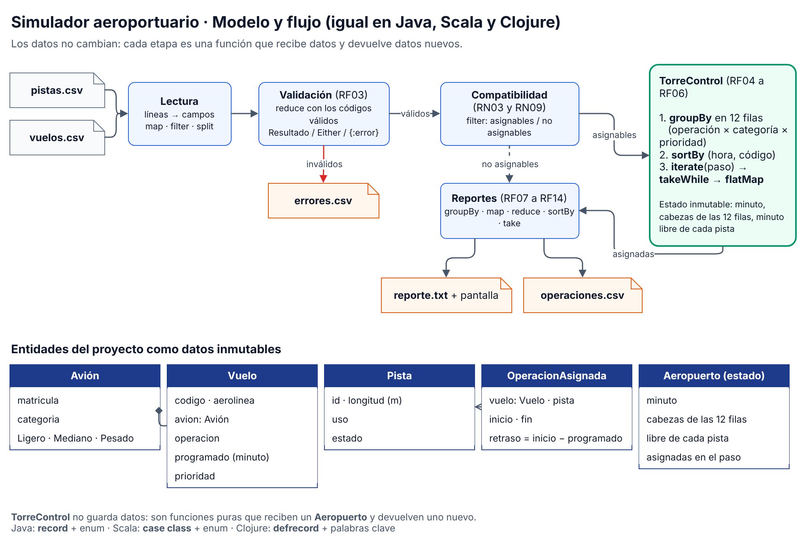

# 02 · Modelo y contrato funcional

Este documento es el **contrato común** de las tres versiones. Si Java, Scala y Clojure lo cumplen,
producen archivos de salida **idénticos byte a byte** con las mismas entradas (RNF01). Todo lo que no esté
aquí es libre en cada lenguaje.



## 1. Ejecución

```
java -jar simulador-<lenguaje>.jar <pistas.csv> <vuelos.csv> <carpeta_salida>
```

| Situación | Comportamiento | Código de salida |
|---|---|---|
| Ejecución normal, aunque haya registros inválidos | Escribe los 3 archivos de salida y muestra `reporte.txt` en pantalla | 0 |
| Faltan argumentos, o un archivo de entrada no existe o no se puede leer | Muestra `ERROR: <motivo>` y el modo de uso. No escribe nada | 2 |

Archivos que escribe en `<carpeta_salida>` (la crea si no existe):

| Archivo | Contenido | RF |
|---|---|---|
| `operaciones.csv` | Programa final de operaciones | RF05, RF06, RF07 |
| `errores.csv` | Registros inválidos y su motivo | RF03 |
| `reporte.txt` | Reportes y resumen | RF08 a RF14 |

## 2. Archivos de entrada

**Reglas comunes**
1. Codificación UTF-8. Las líneas terminan en `\n` (también se acepta `\r\n`).
2. La **línea 1 es el encabezado** y no se valida.
3. Las líneas vacías o con solo espacios **se ignoran** y no cuentan como registro.
4. Cada registro se separa por comas **conservando los campos vacíos**, incluidos los del final:
   `a,b,` tiene 3 campos. En Java y Scala se usa `split(",", -1)`.
5. A cada campo se le quitan los espacios de los extremos (`trim`).
6. Los valores de la lista cerrada deben coincidir **exactamente**, con mayúsculas y minúsculas: `Mixta` es
   válido y `mixta` no.
7. El número de línea que se reporta es la **línea física del archivo** (el encabezado es la línea 1).

**`pistas.csv`**: 4 campos

| Campo | Tipo | Valores |
|---|---|---|
| `id` | texto | no vacío, único |
| `longitud` | entero | metros, mayor que 0 |
| `uso` | lista | `Despegue` · `Aterrizaje` · `Mixta` |
| `estado` | lista | `Operativa` · `Cerrada` |

**`vuelos.csv`**: 8 campos

| Campo | Tipo | Valores |
|---|---|---|
| `codigo` | texto | no vacío, único |
| `aerolinea` | texto | no vacío |
| `matricula` | texto | no vacío |
| `categoria` | lista | `Ligero` · `Mediano` · `Pesado` |
| `operacion` | lista | `Despegue` · `Aterrizaje` |
| `dia` | entero | 1 a 9999 |
| `hora` | hora | `HH:MM`, de `00:00` a `23:59`, siempre con 2 dígitos |
| `prioridad` | lista | `Normal` · `Emergencia` |

**Definiciones**
- **Entero:** cumple la expresión `-?[0-9]{1,9}`. No se acepta `+5`, `1.5` ni números de más de 9 dígitos;
  sí se acepta `007`, que vale 7.
- **Hora:** cumple `[0-9]{2}:[0-9]{2}`, con horas de 00 a 23 y minutos de 00 a 59.
- **Minuto absoluto:** `(dia − 1) · 1440 + HH · 60 + MM`. Todos los tiempos internos son enteros de 64 bits.

## 3. Validación (RF03)

- Cada registro se valida **en el orden de las columnas**, y solo se reporta **el primer error**.
- La unicidad (`id`, `codigo`) se comprueba contra los registros **válidos anteriores**: un registro inválido
  no reserva su código. Por eso la validación es una reducción (`fold`/`reduce`) que lleva el conjunto de
  códigos válidos.
- Primero se valida todo `pistas.csv` y después `vuelos.csv`.

**Mensajes exactos** (`<valor>` es el texto del campo después de `trim`):

| Archivo | Regla | Mensaje |
|---|---|---|
| ambos | número de campos | `se esperaban 4 campos y hay <n>` (pistas) · `se esperaban 8 campos y hay <n>` (vuelos) |
| pistas | id | `id vacío` · `id repetido: <valor>` |
| pistas | longitud | `longitud no es un entero: <valor>` · `longitud debe ser mayor que 0: <valor>` |
| pistas | uso | `uso con valor no válido: <valor> (valores: Despegue/Aterrizaje/Mixta)` |
| pistas | estado | `estado con valor no válido: <valor> (valores: Operativa/Cerrada)` |
| vuelos | codigo | `código vacío` · `código repetido: <valor>` |
| vuelos | aerolinea | `aerolínea vacía` |
| vuelos | matricula | `matrícula vacía` |
| vuelos | categoria | `categoría con valor no válido: <valor> (valores: Ligero/Mediano/Pesado)` |
| vuelos | operacion | `operación con valor no válido: <valor> (valores: Despegue/Aterrizaje)` |
| vuelos | dia | `día no es un entero: <valor>` · `día debe estar entre 1 y 9999: <valor>` |
| vuelos | hora | `hora no válida: <valor> (formato HH:MM de 00:00 a 23:59)` |
| vuelos | prioridad | `prioridad con valor no válido: <valor> (valores: Normal/Emergencia)` |

Ningún mensaje contiene comas propias, así que `errores.csv` no necesita comillas. Un valor tampoco puede
traer comas, porque el registro ya se separó por ellas.

## 4. Modelo de datos

| Concepto | Java | Scala | Clojure |
|---|---|---|---|
| Avión | `record Avion(String matricula, Categoria categoria)` | `case class Avion(matricula: String, categoria: Categoria)` | `(defrecord Avion [matricula categoria])` |
| Vuelo | `record Vuelo(String codigo, String aerolinea, Avion avion, Operacion operacion, long programado, Prioridad prioridad)` | `case class Vuelo(...)` con los mismos campos | `(defrecord Vuelo [codigo aerolinea avion operacion programado prioridad])` |
| Pista | `record Pista(String id, int longitud, Uso uso, Estado estado)` | `case class Pista(...)` | `(defrecord Pista [id longitud uso estado])` |
| Operación asignada | `record OperacionAsignada(Vuelo vuelo, String pista, long inicio, long fin)` (el retraso se calcula: `inicio − programado`) | `case class OperacionAsignada(...)` | `(defrecord OperacionAsignada [vuelo pista inicio fin])` |
| Aeropuerto (estado de la simulación) | `record Aeropuerto(long minuto, List<Integer> cabezas, List<Long> libres, List<OperacionAsignada> asignadasEnElPaso)` | `case class Aeropuerto(...)` | mapa `{:minuto … :cabezas … :libres … :asignadas …}` |
| Listas cerradas | `enum Categoria`, `enum Operacion`, `enum Uso`, `enum Estado`, `enum Prioridad` | `enum` de Scala 3 | palabras clave: `:ligero`, `:aterrizaje`… |
| Resultado de validar | `sealed interface Resultado<T>` con `record Ok<T>(T valor)` y `record Error<T>(String motivo)` | `Either[String, T]` | `{:ok valor}` o `{:error motivo}` |
| TorreControl | clase `final` con métodos `static` puros | `object TorreControl` | espacio de nombres `torre` |

**Módulos** (los mismos en los tres; el de Medición se agrega en el Bloque 3):

| Módulo | Responsabilidad | Operaciones funcionales principales |
|---|---|---|
| Modelo | Entidades, listas cerradas y requisitos por categoría (RN02) | — |
| Lectura | Leer archivos y convertir cada línea en campos | `map`, `filter`, `split` |
| Validación | Reglas de la sección 3; separar válidos de errores | `reduce`/`fold`, Resultado/`Either` |
| TorreControl | Compatibilidad (RN03), no asignables (RN09) y simulación (sección 5) | `filter`, `groupBy`, `sortBy`, `iterate`, `takeWhile`, `flatMap`, `min` |
| Reportes | RF07 a RF14 y formato de salida | `groupBy`, `map`, `reduce`, `sortBy`, `take` |
| Main | Leer los argumentos, encadenar los módulos y escribir los archivos | composición de funciones |

## 5. Algoritmo de TorreControl

**Preparación** (una sola vez):
1. `asignables` = vuelos válidos que tienen al menos una pista compatible (RN03). Los demás van a RF12 con
   su motivo (RN09).
2. Se agrupan los asignables en **12 filas** por (operación, categoría, prioridad), con `groupBy`.
3. Cada fila se ordena por (minuto programado, código), con `sortBy`.
4. Las pistas operativas se ordenan por `id`.

**¿Por qué 12 filas dan el mismo resultado que recorrer toda la cola (RN06)?** Todos los vuelos de una fila
tienen la misma operación y categoría, así que son compatibles con las mismas pistas. Si el primero de la fila
no tiene pista libre compatible, ninguno de la fila la tiene. Basta entonces mirar el primer vuelo de cada
fila, y el elegido es siempre el mismo que se obtendría recorriendo la cola completa.

**Estado** (`Aeropuerto`, inmutable):
- `minuto` actual;
- `cabezas`: posición del primer vuelo pendiente en cada fila (12 enteros);
- `libres`: minuto en que se libera cada pista (0 al inicio);
- `asignadasEnElPaso`: operaciones asignadas en ese paso.

**Estado inicial:** `minuto` = la hora programada más temprana entre los asignables; todas las cabezas en 0;
todas las pistas libres desde 0; ninguna asignación.

**Paso** (función pura `Aeropuerto → Aeropuerto`):
1. **Candidatos:** el primer vuelo de cada fila, si existe y su hora programada ≤ `minuto`.
2. Entre los candidatos que tienen alguna pista **libre** (`libre ≤ minuto`) y compatible, se elige el de mayor
   prioridad según RN05: (emergencia, aterrizaje, programado, código).
3. Se le asigna la pista libre compatible de **menor id**: inicio = `minuto`, fin = `minuto` + ocupación
   (RN02). La pista queda libre en `fin` y la cabeza de esa fila avanza una posición.
4. Se repiten 1 a 3 en el mismo minuto hasta que ningún candidato tenga pista libre compatible.
5. **Siguiente minuto:** el menor entre (a) los `libre` mayores que el minuto actual y (b) las horas
   programadas de los primeros de cada fila que sean mayores que el minuto actual.

**Fin:** un estado está **terminado** si no quedan vuelos pendientes en ninguna fila **y** su paso no asignó nada. Así el último paso que sí asignó operaciones queda incluido en el resultado.

**Ejecución en cada lenguaje.** La secuencia de estados se genera de forma perezosa y se recogen las
operaciones de cada paso:

| Java | Scala | Clojure |
|---|---|---|
| `Stream.iterate(inicial, a -> !a.terminado(), TorreControl::paso).flatMap(a -> a.asignadasEnElPaso().stream()).toList()` | `Iterator.iterate(inicial)(paso).takeWhile(!_.terminado).flatMap(_.asignadasEnElPaso).toList` | `(->> (iterate paso inicial) (take-while (complement terminado?)) (mapcat :asignadas) vec)` |

**Costo:** se ordena una vez (proporcional a n·log n). Después cada paso cuesta lo mismo sin importar cuántos
vuelos haya (12 filas y k pistas), y hay como máximo 2 eventos por vuelo. Ningún lenguaje necesita
colecciones especiales: solo listas inmutables y enteros. **No hay recursión profunda**, lo que importa
porque Java no optimiza la recursión de cola.

## 6. Archivos de salida

**Formato de números y horas (RNF07)**
- Decimales con **punto** y **2 cifras**, redondeo `HALF_UP`. En los tres lenguajes se usa el formateador de
  Java con `Locale.ROOT`.
- Horas como `D<día> HH:MM`. Ejemplo: el minuto 1.935 se escribe `D2 08:15`.
- Retrasos y ocupaciones en minutos enteros.
- Promedios: la suma entera dividida entre la cantidad, calculada una sola vez como número decimal.
- Ordenamiento de texto: comparación de cadenas estándar de la JVM (`compareTo`), la misma en los tres.

**`operaciones.csv`** (RF07), en orden de asignación: por minuto de inicio y, dentro del mismo minuto, en el
orden de prioridad en que se asignaron.
```
codigo,aerolinea,operacion,categoria,prioridad,pista,programada,inicio,fin,retraso
CM304,Copa,Aterrizaje,Mediano,Emergencia,P01,D1 08:01,D1 08:03,D1 08:06,2
```

**`errores.csv`** (RF03): primero los de pistas y luego los de vuelos, cada grupo por número de línea.
```
archivo,linea,motivo
vuelos,11,categoría con valor no válido: Jumbo (valores: Ligero/Mediano/Pesado)
```

**`reporte.txt`** (RF08 a RF14). Cada sección empieza con `== RFxx · Título ==`, y entre secciones hay una
línea vacía. El texto exacto está en [`datos/ejemplo/esperado/reporte.txt`](../datos/ejemplo/esperado/reporte.txt).
Reglas de cada sección:

| Sección | Regla | Si no hay datos |
|---|---|---|
| RF03 | Registros, válidos e inválidos por archivo | — |
| RF08 | Asignadas, promedio, máximo, retrasados (más de 15 min) y su porcentaje | `Sin datos` en cada valor |
| RF09 | Los 5 primeros por retraso descendente; si empatan, por código ascendente | `Sin datos` |
| RF10 | Período desde la primera hora programada asignada hasta el último `fin`; todas las pistas válidas por id, incluidas las cerradas | `Sin datos` |
| RF11 | Promedio por aerolínea, descendente; si empatan, por nombre ascendente | `Sin datos` |
| RF12 | Vuelos no asignables en el orden del archivo | `Ninguno` |
| RF13 | Aterrizaje, Despegue, Ligero, Mediano, Pesado, siempre en ese orden e incluyendo los ceros | — |
| RF14 | Totales; pista más usada (más operaciones; si empatan, el id menor); aerolínea con mayor promedio (la primera de RF11) | `Sin datos` |

La pantalla muestra exactamente el contenido de `reporte.txt`.

## 7. Ejemplo resuelto a mano

Entradas: [`datos/ejemplo/pistas.csv`](../datos/ejemplo/pistas.csv) y
[`datos/ejemplo/vuelos.csv`](../datos/ejemplo/vuelos.csv).

**Pistas válidas:**
- P01: 2.600 m, Mixta, Operativa.
- P02: 2.200 m, solo Despegue, Operativa.
- P03: 1.500 m, solo Aterrizaje, Operativa.
- P04: 3.500 m, Aterrizaje, **Cerrada**.
- La línea de P05 es inválida (`abc`).

**Compatibilidades que resultan:**
- Aterrizaje de Ligero: P01 o P03.
- Aterrizaje de Mediano: solo P01.
- Despegue de Ligero o Mediano: P01 o P02.
- Pesado: **ninguna**. P01 mide 2.600 m (le faltan 200) y P04 está cerrada. Por eso AV108 va a RF12.

**Recorrido** (todo ocurre el día 1):

| Minuto | En espera, en orden de prioridad | Pistas libres | Qué asigna la torre |
|---|---|---|---|
| 08:00 | AV101 (aterrizaje mediano), LA202 (despegue mediano) | P01 P02 P03 | AV101 → P01 (08:00–08:03) · LA202 → P02 (08:00–08:03) |
| 08:01 | **CM304 (emergencia)**, AV103 (aterrizaje ligero) | P03 | CM304 solo puede usar P01, que está ocupada, así que espera. **No bloquea:** AV103 → P03 (08:01–08:03) |
| 08:02 | CM304, AV105, LA206 | ninguna | — |
| 08:03 | CM304, CM307, AV105, LA206 | P01 P02 P03 | CM304 → P01 (retraso 2) · CM307 necesita P01 y espera · AV105 → P02 (retraso 1; empata a las 08:02 con LA206 y gana por código) · LA206 espera |
| 08:04 | CM307, LA206, LA209 | P03 | Ninguno puede usar P03 |
| 08:06 | CM307, LA206, LA209 | P01 P02 P03 | CM307 → P01 (retraso 3) · LA206 → P02 (retraso 4) · LA209 espera |
| 08:08 | LA209 | P02 P03 | LA209 → P02 (retraso 4) |
| 08:20 | LA213 | todas | LA213 → P01 (retraso 0) |

**Resultado:** 9 operaciones. Retrasos 0, 0, 0, 2, 1, 3, 4, 4 y 0 → promedio 14 / 9 = **1,56 min**, máximo
**4 min**, ningún vuelo con más de 15 min de retraso. El período va de 08:00 a 08:22 (22 min):
- P01: 11 min ocupada (50,00 %);
- P02: 11 min (50,00 %);
- P03: 2 min (9,09 %).

Las salidas esperadas completas están en [`datos/ejemplo/esperado/`](../datos/ejemplo/esperado/). Se
calcularon a mano y se verificaron con un script de referencia. Son la primera prueba de equivalencia del
Bloque 5.

## 8. Verificación de equivalencia

Una versión cumple el contrato si, con las mismas entradas, sus tres archivos son **idénticos byte a byte** a
los esperados:

```
diff -r salida_<lenguaje>/ datos/<escenario>/esperado/
```

En los escenarios grandes del Bloque 3 se comparan además las tres versiones entre sí.
